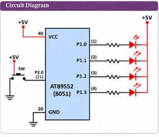

# EXPERIMENT DETAILS

**EXP:** CONTINUOUS ASSESSMENT 3  
**NAME OF EXP:** Timer-Based LED Pattern Generator and Button Interrupt Controller  
**HARDWARE SETUP / PLATFORM:** 8051 Development Board (AT89S52), Keil µVision

---

## TASK 3A: FOUR-STATE LED PATTERN GENERATOR WITH BUTTON CONTROL

### 1. Aim

To design and implement a GPIO-based LED pattern generator using the 8051 microcontroller. Four LEDs display different patterns, and a push button is used to switch between the four operating modes.

### 2. Circuit Diagram

The circuit uses four LEDs connected to Port 1 and a push button connected to Port 2. The LEDs are connected in active-low configuration.



### 3. Core Logic / Working Principle

The program controls four LEDs using GPIO pins P1.0 to P1.3. A push button connected to P2.0 is used to change the operating mode.

The system has four modes:

1. **Mode 1 – Running LED:** LEDs turn ON one after another from LED0 to LED3.
2. **Mode 2 – Binary Counter:** The four LEDs display a 4-bit binary count.
3. **Mode 3 – Alternating Pattern:** LEDs alternate between the patterns 1010 and 0101.
4. **Mode 4 – All LED Flash:** All four LEDs turn ON and OFF alternately.

The `keypress()` function detects a button press and waits until the button is released to avoid repeated detection while it is held. The `intr()` function increments the mode and resets the counter. The `delay()` function provides a visible delay and checks for button presses during the pattern execution.

### 4. Pseudocode

1. Initialize the mode and counter to zero.
2. Continuously check whether the push button is pressed.
3. If pressed, increment the mode and reset the counter.
4. Execute the LED pattern corresponding to the current mode.
5. Use delay between LED transitions.
6. Repeat continuously.

### 5. Code Base

```c
#include <reg51.h>

sbit SW = P2^0;
int mode=0;
int num=0;
sbit led0 = P1^0;
sbit led1 = P1^1;
sbit led2 = P1^2;
sbit led3 = P1^3;

int keypress()
{
    if(SW == 0) {
        while(SW == 0);
        return 1;
    }
    return 0;
}

int intr()
{
    if(keypress()) {
        mode = (mode + 1) % 4;
        num = 0;
        return 1;
    }
    return 0;
}

int delay()
{
    int i, j;
    for(i = 0; i < 300; i++) {
        for(j = 0; j < 400; j++);
        if(intr())
            return 1;
    }
    return 0;
}

void counter()
{
    int a;
    if(intr())
        return;

    a = num;
    led0 = !(a % 2);
    a /= 2;
    led1 = !(a % 2);
    a /= 2;
    led2 = !(a % 2);
    a /= 2;
    led3 = !(a % 2);

    if(delay())
        return;
}

void runningled()
{
    if(intr())
        return;

    led0 = 0; led1 = 1; led2 = 1; led3 = 1;
    if(delay()) return;

    led0 = 1; led1 = 0;
    if(delay()) return;

    led1 = 1; led2 = 0;
    if(delay()) return;

    led2 = 1; led3 = 0;
    if(delay()) return;

    led3 = 1;
}

void alternate_toggle()
{
    if(intr())
        return;

    led0 = 0; led1 = 1; led2 = 0; led3 = 1;
    if(delay()) return;

    led0 = 1; led1 = 0; led2 = 1; led3 = 0;
    if(delay()) return;
}

void allonoff()
{
    if(intr())
        return;

    led0 = 0; led1 = 0; led2 = 0; led3 = 0;
    if(delay()) return;

    led0 = 1; led1 = 1; led2 = 1; led3 = 1;
    if(delay()) return;
}

void main()
{
    while(1)
    {
        if(intr())
            continue;

        switch(mode)
        {
            case 0:
                runningled();
                break;

            case 1:
                num++;
                counter();
                break;

            case 2:
                alternate_toggle();
                break;

            case 3:
                allonoff();
                break;
        }
    }
}
```

### 6. Inference

The experiment demonstrates GPIO control using the 8051 microcontroller. Four different LED patterns are generated, and a push button is used to switch between operating modes. The program also demonstrates button-press detection, software debouncing, and delay-based timing.

