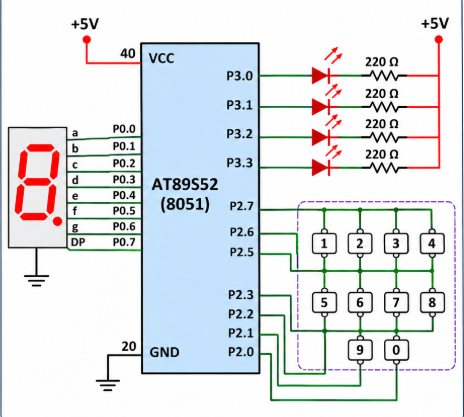

# EXPERIMENT DETAILS

**EXP:** CONTINUOUS ASSESSMENT 5  
**NAME OF EXP:** Keypad Controlled LED Operations with Seven-Segment Display  
**HARDWARE SETUP / PLATFORM:** 8051 Development Board (AT89S52), Keil µVision

---

## TASK 5A: KEYPAD CONTROLLED LED OPERATIONS

### 1. Aim

To interface a matrix keypad with the 8051 microcontroller and control four LEDs according to the pressed key. The selected key is also displayed on a seven-segment display.

### 2. Circuit Diagram

### 3. Core Logic / Working Principle

The system uses a 3 × 4 matrix keypad, four LEDs, and a seven-segment display.

- **Keypad:** P2.7, P2.6 and P2.5 are used as row-selection pins. P2.3–P2.0 are used as column input pins.
- **Seven-segment display:** Connected to Port 0 (P0.0–P0.7) to display the pressed digit.
- **LEDs:** Four LEDs are connected to P3.0–P3.3.

The `keypad_scan()` function scans the keypad rows and detects the pressed key. The `display_digit()` function displays the selected digit on the seven-segment display.

The `led_control()` function controls individual LEDs, while other functions generate running, alternating, binary-counter, and blinking patterns.

### 4. Key Functions

| Key | Operation |
|---|---|
| 1 | Turn ON LED1 only |
| 2 | Turn ON LED2 only |
| 3 | Turn ON LED3 only |
| 4 | Turn ON LED4 only |
| 5 | Running LED pattern |
| 6 | Alternating LED pattern |
| 7 | Binary counter (0–15) |
| 8 | Blink all LEDs |
| 9 | Turn OFF all LEDs |
| 0 | Reset display and turn OFF all LEDs |

### 5. Pseudocode

1. Initialize all LEDs to OFF and clear the display.
2. Scan the keypad continuously.
3. Identify the pressed key.
4. Display the corresponding digit on the seven-segment display.
5. Execute the LED operation associated with the pressed key.
6. Continue scanning the keypad during delays so a new key can change the operation.
7. Repeat continuously.

### 6. Inference

The experiment demonstrates matrix keypad interfacing, seven-segment display control, and multiple LED operations using the 8051 microcontroller. Different LED patterns are selected through keypad input, providing a simple user-controlled embedded system.

