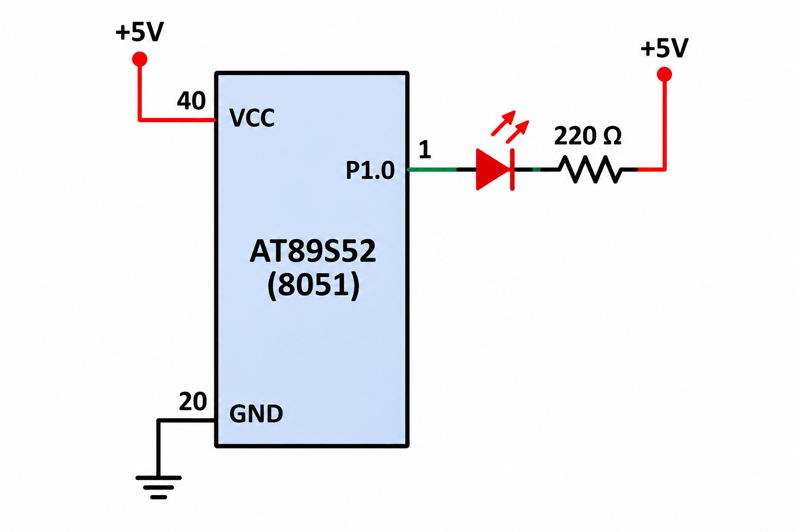

# EXPERIMENT DETAILS

**EXP:** CONTINUOUS ASSESSMENT 5  
**NAME OF EXP:** Hardware Timer and Interrupt-Based LED Blinking  
**HARDWARE SETUP / PLATFORM:** 8051 Development Board (AT89S52), Keil µVision

---

## TASK 1: TIMER0 INTERRUPT-BASED LED CONTROL

### 1. Aim

To configure Timer 0 of the 8051 microcontroller to generate periodic interrupts and use the timer interrupt to toggle an LED every one second without using software delay loops.

### 2. Circuit Diagram



### 3. Core Logic / Working Principle

Timer 0 is configured in Mode 1, which is a 16-bit timer mode. The timer is loaded with `TH0 = 0xFC` and `TL0 = 0x66` to generate an approximately 1 ms interrupt interval when using an 11.0592 MHz crystal.

The Timer 0 interrupt service routine executes every 1 ms and increments the `ms_count` variable. When the count reaches 1000, the counter is reset and the LED connected to P1.0 is toggled.

### 4. Key Steps

1. Configure Timer 0 in Mode 1 using `TMOD = 0x01`.
2. Load the timer registers with `TH0 = 0xFC` and `TL0 = 0x66`.
3. Enable the Timer 0 interrupt using `ET0 = 1`.
4. Enable global interrupts using `EA = 1`.
5. Start Timer 0 using `TR0 = 1`.
6. Increment the millisecond counter inside the interrupt service routine.
7. Toggle the LED whenever the counter reaches 1000.

### 5. Code Base

```c
#include <reg52.h>

sbit LED = P1^0;

unsigned int ms_count = 0;

void Timer0_ISR(void) interrupt 1
{
    // Reload Timer 0 for approximately 1 ms
    TH0 = 0xFC;
    TL0 = 0x66;

    ms_count++;

    // 1000 x 1 ms = approximately 1 second
    if(ms_count >= 1000)
    {
        ms_count = 0;
        LED = ~LED;
    }
}

void Timer0_Init(void)
{
    // Timer 0 Mode 1: 16-bit timer
    TMOD = 0x01;

    // Load initial value
    TH0 = 0xFC;
    TL0 = 0x66;

    // Enable Timer 0 interrupt
    ET0 = 1;

    // Enable global interrupts
    EA = 1;

    // Start Timer 0
    TR0 = 1;
}

void main(void)
{
    // Initialize LED
    LED = 0;

    // Initialize Timer 0
    Timer0_Init();

    // Main program does not use software delay
    while(1)
    {
    }
}
```

### 6. Expected Result

The LED connected to P1.0 toggles every approximately one second using Timer 0 interrupts, without software delay loops.

### 7. Inference

The experiment demonstrates hardware timer configuration and interrupt-based timing using the 8051 microcontroller. A millisecond time base is generated using Timer 0 and used to control LED blinking at one-second intervals.

