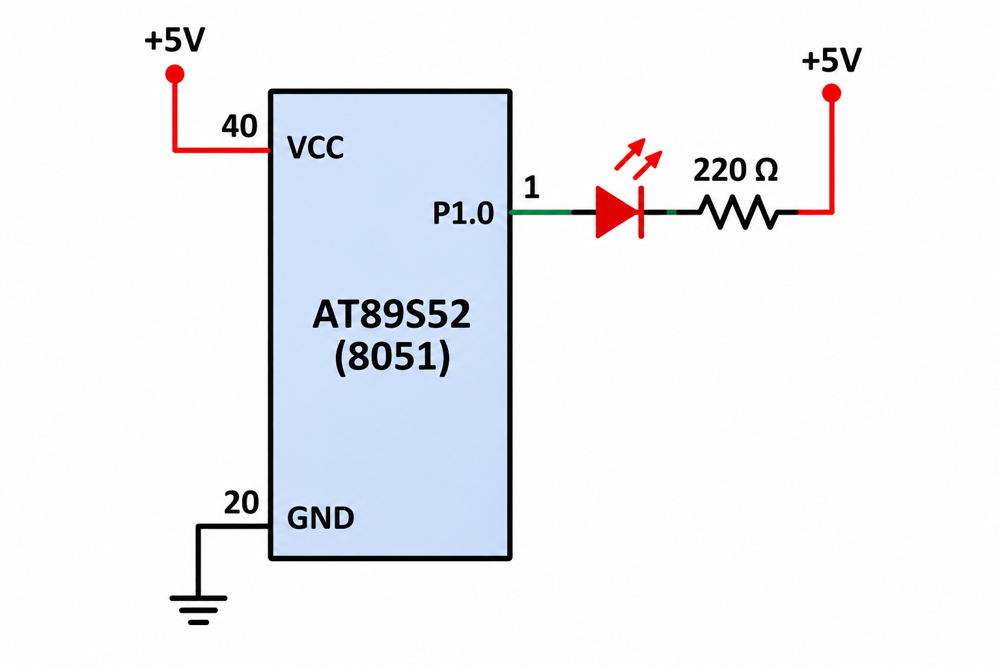

# EXPERIMENT DETAILS

**EXP:** CONTINUOUS ASSESSMENT 5  
**NAME OF EXP:** LED Fading Using Software PWM  
**HARDWARE SETUP / PLATFORM:** 8051 Development Board (AT89S52), Keil µVision

---

## TASK 2: LED BRIGHTNESS CONTROL USING SOFTWARE PWM

### 1. Aim

To generate a software PWM signal using Timer 0 interrupts of the 8051 microcontroller and gradually vary the brightness of an LED by changing its duty cycle.

### 2. Circuit Diagram

### 3. Core Logic / Working Principle

The Timer 0 interrupt configured in Task 1 is used to generate periodic timing events. These interrupts are used to generate a software PWM signal to control the LED brightness.

PWM (Pulse Width Modulation) controls the average power supplied to an LED by changing the duty cycle of the signal.

The duty cycle is gradually increased from 0% to 100% and then decreased from 100% to 0%.

**Duty Cycle = (ON Time / Total Time) × 100**

### 4. Duty Cycle and LED Brightness

| Duty Cycle | LED Brightness |
|---|---|
| 0% | OFF |
| 25% | Dim |
| 50% | Medium |
| 75% | Bright |
| 100% | Fully ON |

### 5. Key Steps

1. Configure Timer 0 to generate periodic interrupts.
2. Use the timer interrupt to generate a software PWM signal.
3. Set the initial duty cycle to 0%.
4. Gradually increase the duty cycle up to 100%.
5. Gradually decrease the duty cycle back to 0%.
6. Repeat the process to produce a continuous LED fading effect.
7. Use an approximate PWM frequency of 500 Hz–1 kHz.

### 6. Code Base

The implementation uses the Timer 0 interrupt from Task 1 to generate software PWM. The duty cycle is varied gradually to control LED brightness.

### 7. Expected Result

The LED gradually increases in brightness from OFF to fully ON and then fades back to OFF continuously.

### 8. Inference

The experiment demonstrates software PWM generation using timer interrupts. By varying the duty cycle, the brightness of an LED can be controlled smoothly without using hardware PWM peripherals.

