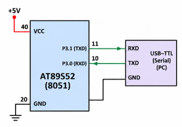

# EXPERIMENT DETAILS

**EXP:** CONTINUOUS ASSESSMENT 6  
**NAME OF EXP:** UART String Transmission Using 8051  
**HARDWARE SETUP / PLATFORM:** 8051 Development Board (AT89S52), Keil µVision

---

## TASK A: TRANSMIT A STRING THROUGH UART

### 1. Aim

To configure the UART of the 8051 microcontroller and continuously transmit the message "Hello from 8051" to a PC using serial communication.

### 2. Circuit Diagram



### 3. Core Logic / Working Principle

The 8051 UART is configured in Mode 1 for 8-bit asynchronous serial communication. Timer 1 is configured in Mode 2 (8-bit auto-reload) to generate a baud rate of 4800.

The `uart_tx()` function sends one character through the SBUF register and waits until the TI flag becomes 1, indicating that transmission is complete.

The `uart_string()` function sends each character of the given string one by one. The main function continuously transmits the message "Hello from 8051".

### 4. Key Steps

1. Configure Timer 1 in Mode 2 using `TMOD = 0x20`.
2. Load TH1 and TL1 with `0xFA` for 4800 baud.
3. Configure UART Mode 1 using `SCON = 0x50`.
4. Start Timer 1 using `TR1 = 1`.
5. Load each character into SBUF.
6. Wait for the TI flag and clear it after transmission.
7. Continuously transmit the message.

### 5. Code Base

```c
#include <reg51.h>

void uart_init(void)
{
    TMOD = 0x20;
    TH1 = 0xFA;
    TL1 = 0xFA;
    SCON = 0x50;
    TR1 = 1;
}

void uart_tx(unsigned char data)
{
    SBUF = data;

    while(TI == 0);

    TI = 0;
}

void uart_string(char *str)
{
    while(*str != '\0')
    {
        uart_tx(*str);
        str++;
    }
}

void main(void)
{
    uart_init();

    while(1)
    {
        uart_string("Hello from 8051\r\n");
    }
}
```

### 6. Expected Result

The message "Hello from 8051" is repeatedly displayed on the PC serial terminal.

### 7. Inference

UART communication is successfully configured using the 8051 microcontroller. The microcontroller continuously transmits a string to the PC using polling-based serial transmission.

