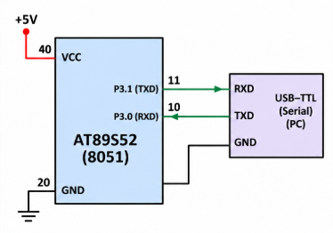

# EXPERIMENT DETAILS

**EXP:** CONTINUOUS ASSESSMENT 6  
**NAME OF EXP:** UART Interrupt-Based Character Echo Using 8051  
**HARDWARE SETUP / PLATFORM:** 8051 Development Board (AT89S52), Keil µVision

---

## TASK B: RECEIVE AND ECHO A CHARACTER USING UART INTERRUPT

### 1. Aim

To receive a character from a PC through UART and transmit the same character back using the serial interrupt of the 8051 microcontroller.

### 2. Circuit Diagram



### 3. Core Logic / Working Principle

The UART is configured in Mode 1 for 8-bit serial communication. Timer 1 operates in Mode 2 to generate the baud rate of 4800.

The serial interrupt is enabled using `ES = 1`, and global interrupts are enabled using `EA = 1`.

When a character is received, the RI flag becomes 1. The interrupt service routine reads the received character from SBUF, clears RI, and writes the character back into SBUF to transmit it to the PC.

When transmission is complete, the TI flag is cleared.

### 4. Key Steps

1. Configure Timer 1 in Mode 2.
2. Load TH1 and TL1 with `0xFA`.
3. Configure UART Mode 1 using `SCON = 0x50`.
4. Enable serial and global interrupts.
5. Start Timer 1.
6. When RI becomes 1, read the received character from SBUF.
7. Clear RI and write the character back to SBUF.
8. Clear TI after transmission is complete.

### 5. Code Base

```c
#include <reg51.h>

void uart_init(void)
{
    TMOD = 0x20;

    TH1 = 0xFA;
    TL1 = 0xFA;

    SCON = 0x50;

    TR1 = 1;

    ES = 1;
    EA = 1;
}

void uart_isr(void) interrupt 4
{
    char received;

    if(RI == 1)
    {
        received = SBUF;
        RI = 0;

        SBUF = received;
    }

    if(TI == 1)
    {
        TI = 0;
    }
}

void main(void)
{
    uart_init();

    while(1)
    {
    }
}
```

### 6. Expected Result

Any character typed in the PC serial terminal is received by the 8051 and echoed back to the terminal.

### 7. Inference

UART reception and transmission are successfully implemented using serial interrupts. The experiment demonstrates interrupt-based serial communication between the 8051 microcontroller and a PC.

